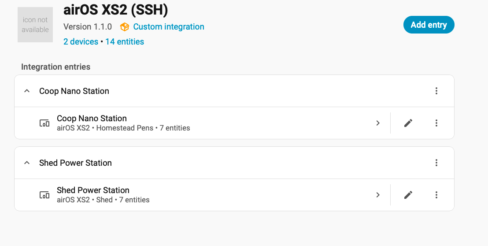
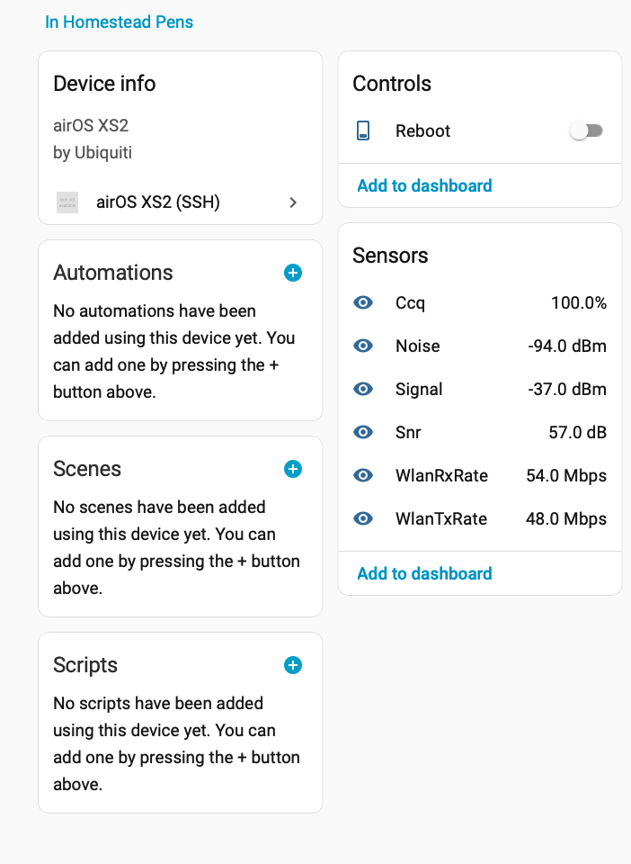
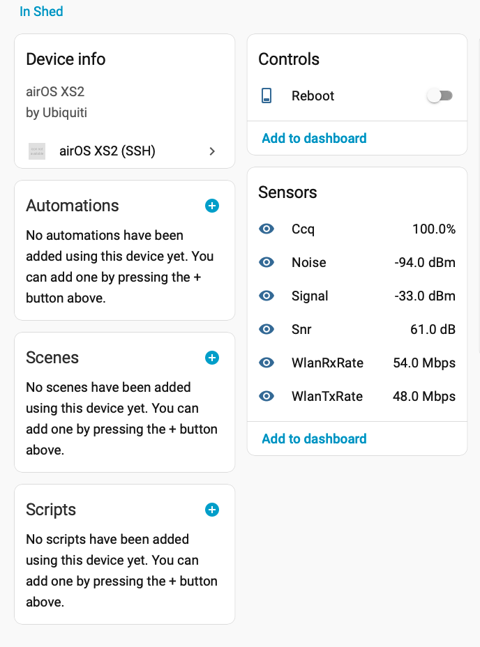

# Ubiquiti AirOS over HTTP (legacy XS5 / airOS 4.0.4)

**Canonical repository:** https://github.com/jonny5509/ha-airos-http  
**Git clone URL:** https://github.com/jonny5509/ha-airos-http.git

Home Assistant custom integration that uses **plain HTTP only** for all communication with the radio. It does not use SSH or HTTPS. For the SSH-based variant, see [ha-airos-ssh](https://github.com/jonny5509/ha-airos-ssh).

**Target firmware:** `XS5.ar2313.v4.0.4.5074.150724.1344` (legacy airOS 4.x).

## Installation

### HACS

1. In HACS, open the custom repositories menu.
2. Add `https://github.com/jonny5509/ha-airos-http` as an **Integration** repository.
3. Install **Ubiquiti AirOS (HTTP)** from that repository and restart Home Assistant.

Use the repository above (the `ha-airos-http` name), not the old `http-AirOS` repository URL. If HACS has the old custom repository saved, remove that entry and add the canonical URL above again.

### Manual

1. Copy `custom_components/airos_xs2` into your Home Assistant `config/custom_components/` directory.
2. Restart Home Assistant.
3. Add **Ubiquiti AirOS (HTTP)** from Settings → Devices & services.
4. Enter the device name, IP address (for example `192.168.1.20`), and the device's web-interface username and password. The integration normalizes the address to `http://`.

## How it works

The integration uses the legacy `/login.cgi` form login and session cookies, then requests `/status.cgi`. All requests are made over HTTP; SSH is not used and no shell commands are run on the radio.

Only sensors represented in the HTTP response can be populated. CPU usage, memory and interface byte counters were previously collected from procfs over SSH, and are **not guaranteed** to be exposed by this HTTP interface. The code should be treated as an initial implementation until tested against the actual radio response.

## Troubleshooting

- Confirm the radio's HTTP web interface is reachable from Home Assistant.
- If sensors remain unavailable, inspect the response from `http://DEVICE-IP/status.cgi` after logging in. Legacy airOS versions may return HTML rather than JSON. Share a sample with passwords, cookies and other secrets removed so the parser can be adapted.
- Plain HTTP does not encrypt credentials or status data. Keep management access on a trusted LAN or VPN and do not expose it to the public internet.
- If HACS tries to download a URL under `/archive/refs/heads/<short-commit>.zip`, it is treating a commit ID as a branch name. Remove the stale custom repository entry, add the canonical repository URL above, and choose the `main` branch if prompted.

## Branding

The HTTP and [SSH integration](https://github.com/jonny5509/ha-airos-ssh) share the same AirOS brand images for a consistent appearance in Home Assistant. The PNG assets are stored in `custom_components/airos_xs2/brand/`:

- `icon.png` — 256 × 256 px
- `icon@2x.png` — 512 × 512 px

## Screenshots

These screenshots are shared with the SSH integration and illustrate the Home Assistant integration/device presentation.

## Firmware

The integration recognizes `4.0.4.5074` as the target NanoStation5 release for its firmware comparison. Verify the hardware model before applying firmware to any device.

## License

[MIT License](LICENSE)
